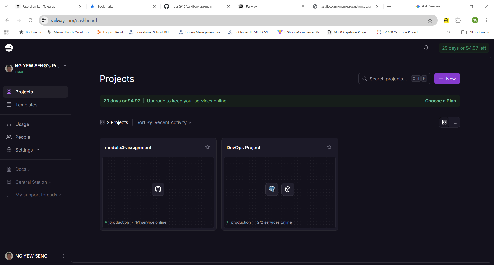
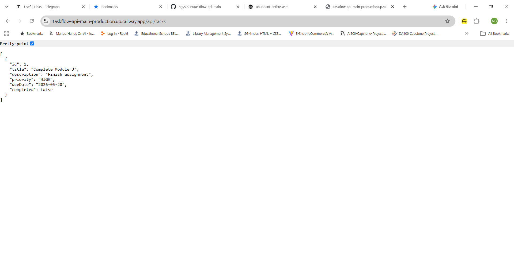
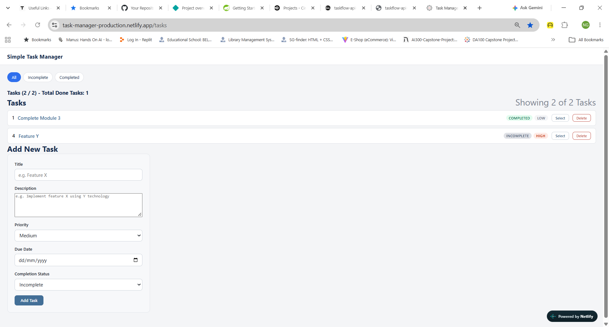

<div align="center">

# Task Manager — Full-Stack (NTU AIE Module 4, Option 2)

[](https://openjdk.org/)
[](https://spring.io/projects/spring-boot)
[](https://react.dev/)
[](https://vite.dev/)
[](#)
[](#license)
[](#docker)
[](https://task-manager-production.netlify.app/)
[](https://taskflow-api-main-production.up.railway.app/api/tasks)

**A React task tracker (M2) wired to a Spring Boot REST API (M3) — Stretch Goal Option 2: add a frontend on Netlify.**

[Live Frontend](https://task-manager-production.netlify.app/) · [Live API](https://taskflow-api-main-production.up.railway.app/api/tasks) · [Report Bug](../../issues) · [Request Feature](../../issues)

</div>

## About

This repository combines two projects from the NTU SCTP AI Engineering programme into one full-stack application:

- **`ntu-aie-m2-frontend`** — a React 19 single-page app (Vite, React Router, Context + Reducer) for listing, filtering, creating, editing and deleting tasks.
- **`ntu-aie-m3-backend`** — *TaskFlow API*, a Spring Boot 4 REST API backed by Spring Data JPA and an in-memory H2 database.

The frontend reads its API address from `VITE_API_BASE_URL`, so the same build can talk to a local backend or the Railway deployment. The backend enables CORS for the Netlify origin, including `PUT` and `DELETE`.

### Key Features

| Feature | Description |
|---|---|
| Task list and filters | Browse tasks and filter by completion status (`all`, `incomplete`, `completed`) |
| Task detail route | `/tasks/:id` to view, edit or delete a single task |
| Create / Read / Update / Delete | Full CRUD through the REST API (`POST`, `GET`, `PUT`, `DELETE`) |
| REST API | `/api/tasks` with layered Controller → Service → Repository design |
| CORS for Netlify | `GET`, `HEAD`, `POST`, `PUT`, `DELETE` allowed from the deployed frontend |
| H2 console | In-memory database inspectable at `/h2-console` during development |
| Containerised backend | Multi-stage Dockerfile (Maven build → slim JRE 21 runtime) |

## Tech Stack

| Category | Technology |
|---|---|
| Frontend | React 19, JSX, CSS Modules, React Router DOM 7, react-spinners |
| State management | React Context API + `useReducer` |
| Build tooling | Vite 8, ESLint 10 |
| Backend | Java 21, Spring Boot 4.1.1 (`spring-boot-starter-webmvc`), Lombok |
| AI/LLM | None |
| Database | H2 in-memory via Spring Data JPA / Hibernate (backend); `json-server` + `data/db.json` for local mock API |
| Build (backend) | Maven (wrapper included) |
| Deployment | Netlify (frontend), Railway (backend), Docker |
| Document processing | Not applicable |

## Architecture

```text
+--------------------------------------------------------+
|              Browser — Netlify (React SPA)             |
|  Header · TaskListPage · TaskDetailPage · AddTaskForm  |
|  Routing: BrowserRouter  (/tasks, /tasks/:id)          |
|  State:   TaskContext + taskReducer                    |
+---------------------------+----------------------------+
                            |  fetch(`${VITE_API_BASE_URL}/tasks`)
                            |  JSON over HTTPS  (CORS)
                            v
+--------------------------------------------------------+
|        TaskFlow API — Spring Boot (Railway / Docker)   |
|  TaskController   /api/tasks  GET · POST · PUT · DELETE |
|          |                                              |
|  TaskService      find · create · update · delete       |
|          |                                              |
|  TaskRepository   Spring Data JpaRepository             |
+---------------------------+----------------------------+
                            |  JPA / Hibernate
                            v
+--------------------------------------------------------+
|     H2 in-memory database  (jdbc:h2:mem:taskflowdb)    |
|     table: tasks (id, title, description, priority,    |
|                   dueDate, completed)                  |
+--------------------------------------------------------+
```

> The H2 database is in-memory, so data resets whenever the backend restarts.

## Project Structure

```text
ntu-aie-m4-option2/
├── README.md
├── ntu-aie-m2-frontend/            # React + Vite client
│   ├── data/db.json                # Mock data for json-server
│   ├── public/                     # Static assets, Netlify _redirects (SPA fallback)
│   ├── img/                        # UI screenshots
│   ├── src/
│   │   ├── App.jsx                 # Routes + API_BASE (VITE_API_BASE_URL)
│   │   ├── main.jsx
│   │   ├── components/             # Header, FilterBar, TaskList, AddTaskForm
│   │   ├── contexts/TaskContext.jsx  # Provider + API calls
│   │   ├── reducers/taskReducer.js
│   │   └── pages/                  # TaskListPage, TaskDetailPage
│   ├── .env.example
│   └── package.json
└── ntu-aie-m3-backend/             # Spring Boot REST API
    ├── Dockerfile
    ├── pom.xml
    ├── mvnw / mvnw.cmd
    ├── screenshots/                # Railway + Netlify evidence
    └── src/main/java/com/taskflow/
        ├── TaskflowApiApplication.java   # Entry point + CORS config
        ├── controller/TaskController.java
        ├── service/TaskService.java
        ├── repository/TaskRepository.java
        └── entity/Task.java
```

## Getting Started

### Prerequisites

- Java 21 (Maven wrapper is included — no separate Maven install needed)
- Node.js 20+ and npm
- Docker (optional)

### 1. Clone

```bash
git clone https://github.com/ngys9919/ntu-aie-m4-option2.git
cd ntu-aie-m4-option2
```

### 2. Run the backend

```bash
cd ntu-aie-m3-backend
./mvnw spring-boot:run        # Windows: mvnw.cmd spring-boot:run
```

The API starts on `http://localhost:8080`. The H2 console is at `http://localhost:8080/h2-console` (JDBC URL `jdbc:h2:mem:taskflowdb`, user `sa`, blank password).

> CORS currently allows only the Netlify origin. For local development, add `http://localhost:5173` to `allowedOrigins(...)` in [TaskflowApiApplication.java](ntu-aie-m3-backend/src/main/java/com/taskflow/TaskflowApiApplication.java).

### 3. Run the frontend

```bash
cd ntu-aie-m2-frontend
npm install
cp .env.example .env
```

Set the API base URL in `.env` (the code appends `/tasks` to it):

```env
VITE_API_BASE_URL=http://localhost:8080/api
```

```bash
npm run dev                   # http://localhost:5173
```

Other scripts: `npm run build`, `npm run preview`, `npm run lint`, and `npm run server` (json-server mock API on port 3001, using `VITE_API_BASE_URL=http://localhost:3001`).

## API Reference

Base path: `/api/tasks`

| Method | Endpoint | Description | Success |
|---|---|---|---|
| GET | `/api/tasks` | List all tasks | `200 OK` |
| GET | `/api/tasks/{id}` | Get one task | `200 OK` |
| POST | `/api/tasks` | Create a task | `201 Created` |
| PUT | `/api/tasks/{id}` | Update a task | `200 OK` |
| DELETE | `/api/tasks/{id}` | Delete a task | `204 No Content` |

Example:

```bash
curl -X POST http://localhost:8080/api/tasks \
  -H "Content-Type: application/json" \
  -d '{"title":"Complete Module 4","description":"Finish assignment","priority":"HIGH","dueDate":"2026-05-20","completed":false}'
```

## Deployment

### Docker

```bash
cd ntu-aie-m3-backend
docker build -t taskflow-api .
docker run -p 8080:8080 taskflow-api
```

### Backend — Railway

Deploy `ntu-aie-m3-backend` (the Dockerfile is detected automatically). Live at <https://taskflow-api-main-production.up.railway.app/api/tasks>.

### Frontend — Netlify

1. Base directory `ntu-aie-m2-frontend`, build command `npm run build`, publish directory `dist`.
2. Set the environment variable `VITE_API_BASE_URL` to `https://taskflow-api-main-production.up.railway.app/api`.
3. `public/_redirects` (`/* /index.html 200`) provides the SPA fallback for client-side routes.

Live at <https://task-manager-production.netlify.app/>.

## Screenshots

| Backend on Railway | Live API | Frontend on Netlify |
|---|---|---|
|  |  |  |

More UI screenshots are in [ntu-aie-m2-frontend/img/](ntu-aie-m2-frontend/img/).

## Contributing

1. Fork the repository.
2. Create a feature branch: `git checkout -b feature/my-change`.
3. Commit your changes and push the branch.
4. Open a Pull Request describing what changed and why.

## License

No license specified.

## Developed By

>> Coder: **Ng Yew Seng (353F)**

>> NTU SCTP AI Engineering

>> for Module 4: DevSecOps - Automating Integration and Deployment

>> © Copyright 2026

## Acknowledgements

- NTU SCTP AIE programme and the TaskFlow API (`taskflow-api-main`) template provided for the assignment.
- [React](https://react.dev/), [Vite](https://vite.dev/), [Spring Boot](https://spring.io/projects/spring-boot), [H2](https://www.h2database.com/), [Netlify](https://www.netlify.com/) and [Railway](https://railway.com/).

---

<div align="center">

If this project helped you, please give it a ⭐

</div>
