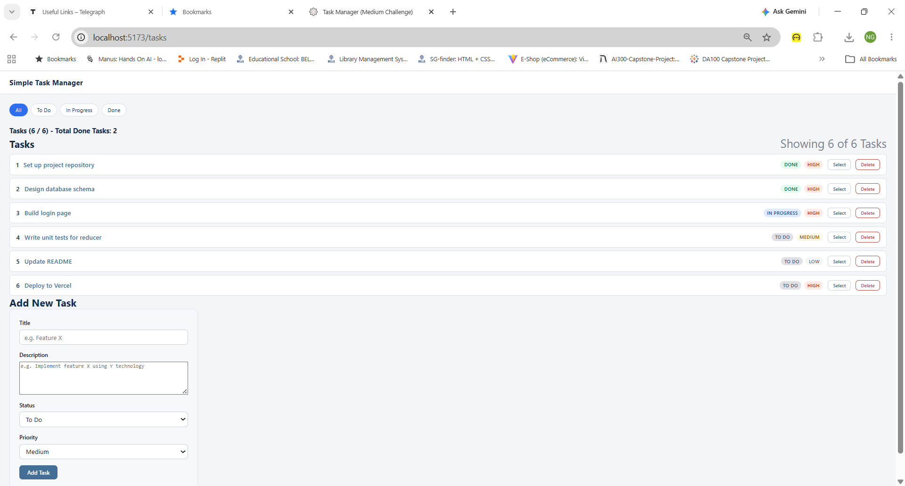
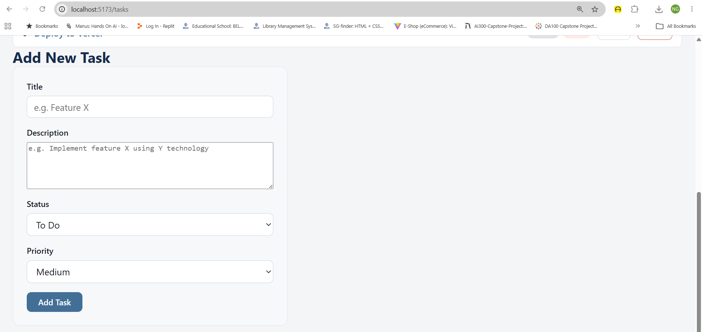
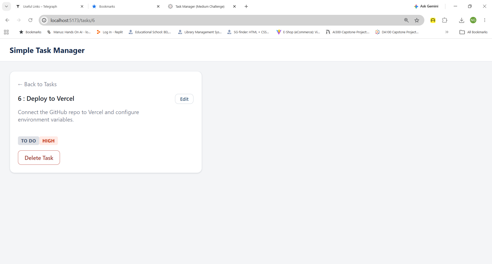
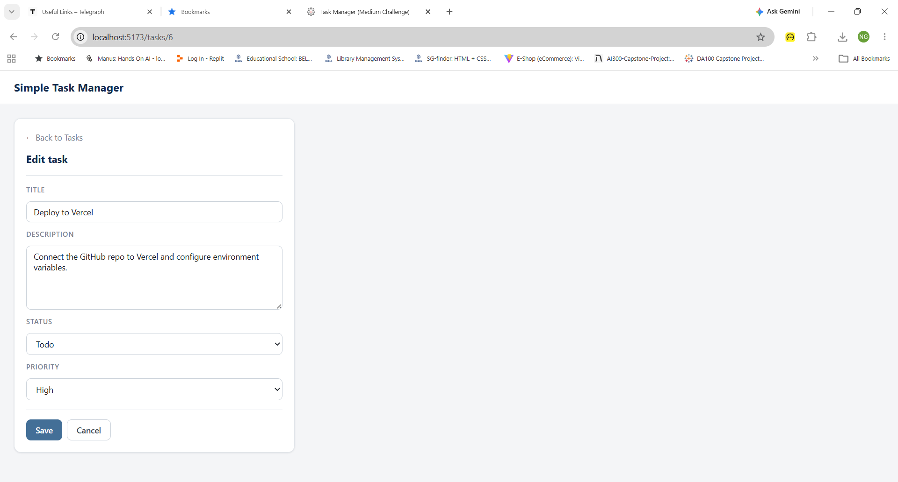
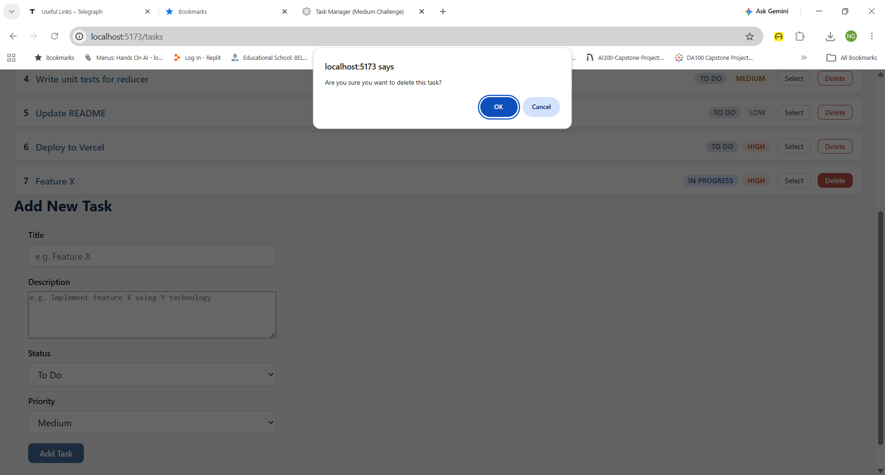

# Task Manager

A small React app for viewing, adding, deleting, and filtering tasks. State lives in a
`useReducer` reducer, is shared through `useContext`, and the app has two routes driven by
React Router.

**Stack:** Vite + React (JavaScript) + React Router. Styling is hand-written plain CSS —
no Tailwind, no Bootstrap, no component library.

---

## Install and run

```bash
cd task-manager
npm install
npm run dev
```

Then open the URL Vite prints (default <http://localhost:5173>). `/` redirects to `/tasks`.

Other scripts:

```bash
npm run build     # production build into dist/
npm run preview   # serve the production build
npm run lint      # oxlint
```

---

## Screenshot

> To capture this: run `npm run dev`, open `/tasks`, and save a screenshot as
> `task-manager/screenshot.png`.

### Landing Page




### filteredTasks [ALL]

![task-manager's filteredTasks [ALL].](img/ntu-sctp-m2-tasks-list-all.png "Filtered Tasks - All")


### filteredTasks [TODO]

![task-manager's filteredTasks [TODO].](img/ntu-sctp-m2-tasks-list-todo.png "Filtered Tasks - To Do")

### filteredTasks [IN-PROGRESS]

![task-manager's filteredTasks [IN-PROGRESS].](img/ntu-sctp-m2-tasks-list-inprogress.png "Filtered Tasks - In-Progress")

### filteredTasks [DONE]

![task-manager's filteredTasks [DONE].](img/ntu-sctp-m2-tasks-list-done.png "Filtered Tasks - Done")


### Add New Task




### View Task




### Edit Task




### Delete Task




---

## Project structure

```
src/
  reducer/
    taskReducer.js      # initialState (6 seed tasks) + taskReducer
  context/
    TaskContext.jsx     # TaskContext, TaskProvider, useTasks() hook
  components/
    Header.jsx          # app name, links back to /tasks
    FilterBar.jsx       # All / To Do / In Progress / Done, highlights the active filter
    TaskList.jsx        # renders filteredTasks; row = title link + badges + Delete
    AddTaskForm.jsx     # controlled form; clears on successful submit
  pages/
    TaskListPage.jsx    # filter bar + list + add form
    TaskDetailPage.jsx  # useParams -> find task -> all fields, or "Task not found"
  App.jsx               # TaskProvider + BrowserRouter + routes, Header on every page
  main.jsx
  index.css
```

### Routes

| Path         | Component        | Notes                        |
| :----------- | :--------------- | :--------------------------- |
| `/`          | —                | Redirects to `/tasks`        |
| `/tasks`     | `TaskListPage`   | List + filter bar + add form |
| `/tasks/:id` | `TaskDetailPage` | Full task detail             |
| `*`          | —                | Redirects to `/tasks`        |

### Reducer actions

| Action type   | Payload                                    | Effect             |
| :------------ | :----------------------------------------- | :----------------- |
| `ADD_TASK`    | task object                                | Appends to `tasks` |
| `DELETE_TASK` | task id                                    | Removes from `tasks` |
| `SET_FILTER`  | `'all' \| 'todo' \| 'in-progress' \| 'done'` | Updates `filter`   |
| `UPDATE_TASK` | task id, task object                         | Updates to `tasks` |

An unknown action type throws, so a typo in a dispatch fails loudly instead of silently
returning the old state.

---

## Design notes

**`filteredTasks` is derived, not stored.** `TaskContext` computes it during render from
`tasks` and `filter`:

```js
const filteredTasks =
  filter === 'all' ? tasks : tasks.filter((task) => task.status === filter);
```

Keeping it out of the reducer means it can never drift out of sync with the task list —
there is one source of truth and the filtered view is recomputed on every render.

**Id generation.** `addTask` assigns `Math.max(...existing ids) + 1` rather than
`tasks.length + 1`, so ids stay unique after deletions. The form only supplies the four
task fields; the context owns the id.

**Route params are strings.** `useParams` gives `id` as a string, so `TaskDetailPage`
compares with `Number(id)`. A non-matching or non-numeric id renders the "Task not found"
message with a link back to the list.

**Form validation.** `AddTaskForm` blocks submission when the title is blank and shows an
inline error; it only resets the fields after a successful `addTask`.

---

## Bonus / extras beyond the brief

- `*` catch-all route redirecting unknown paths to `/tasks`
- Empty state when a filter matches no tasks
- Inline required-title validation on the add form
- Colour-coded status and priority badges, responsive layout down to mobile widths
- Show a task count summary above the list: "Showing X of Y tasks"
- Persist tasks in localStorage so they survive a page reload and saving the new data into it
- Add an UPDATE_TASK action and an inline edit form on the detail page

---

## AI and tools

- **Claude (Claude Code)** — used to scaffold the project structure, write the components
and CSS from the assignment brief, and run the lint/build checks. Every file was reviewed before submission.

- No code was copied from external sources (except the lessons for Module 2: Frontend Web Development). The reducer-plus-context pattern follows the approach described in the React docs:
  
  - <https://react.dev/learn/scaling-up-with-reducer-and-context>
  - <https://reactrouter.com/start/declarative/routing>
